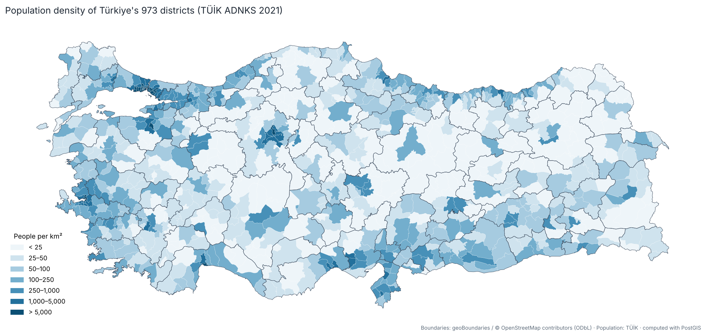
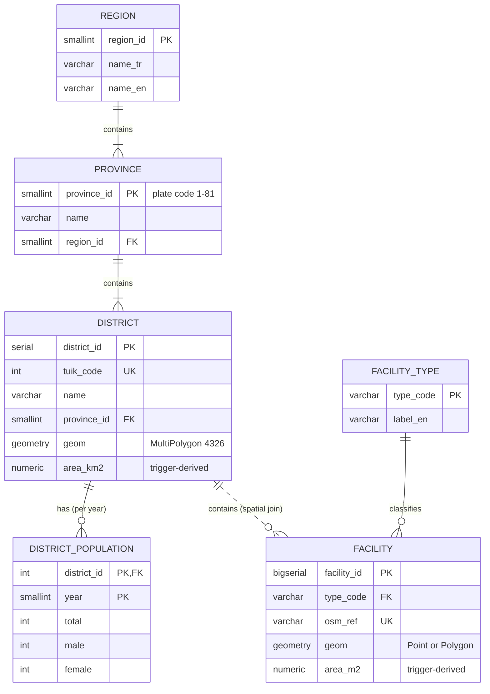

# Türkiye District GIS — a PostGIS city & district information system

[](https://github.com/MustafaBugraBEKDEMiR/turkiye-district-gis/actions/workflows/ci.yml)

A spatial database of **all 81 provinces and 973 districts of Türkiye** in PostgreSQL/PostGIS. It uses real
boundaries (OpenStreetMap) and TÜİK population data, and asks a decision-support question on top of
them: **which districts are under-served by public services such as schools and parks?**

**Live map:** `https://mustafabugrabekdemir.github.io/turkiye-district-gis/` *(GitHub Pages, served from `/docs`)*



The project started as my final project for *MIS533 Database Management Systems* (M.Sc. in Management
Information Systems, Ankara Yıldırım Beyazıt University). That version had 2 tables and 10 hand-typed
rows. This repository rebuilds it at national scale; see [What changed](#from-course-project-to-this-repository).

---

## What it does

| | |
|---|---|
| **Data integration** | Joins two sources that share **no common key**: OSM district polygons and TÜİK population records. Each polygon gets its province from a spatial join, then names are matched in three auditable passes (915 exact, 8 curated aliases, 50 *"Merkez"* districts). The build fails if anything stays unmatched. |
| **Normalized spatial model** | Population is stored per year. Area is derived from geometry by a trigger. Province boundaries are derived from their districts. Facility counts come from spatial joins, not stored columns. |
| **Constraints that mean something** | `CHECK (male + female = total)`, `CHECK (ST_IsValid(geom))`, plate code 1–81, `ON DELETE RESTRICT`, typed geometry columns (`MultiPolygon, 4326`). |
| **Spatial analysis** | Reverse geocoding, adjacency (`ST_Intersects`), geodesic distances (`geography`), k-nearest neighbours (`<->`), shape compactness, topology QA, GeoJSON export. |
| **Decision support** | Per-district indicators: density, share of province, people per school, park m² per person. A **service-gap score** combines them, and a spatial-lag query finds *clusters* of under-served districts. |
| **Performance** | GiST indexes. Assigning 10,000 points to their districts takes **≈145 ms with the index vs ≈2.4 s without** (≈17× faster, `EXPLAIN ANALYZE` in [`04_performance.sql`](sql/queries/04_performance.sql)). |
| **Verified** | 30+ automated checks, e.g. the national total must equal TÜİK's published **84,680,273**, İstanbul **15,840,900**, Kızılay must fall in Çankaya. They run on every push via GitHub Actions. |

## Quick start

**With Docker** (nothing else to install):

```bash
docker compose up --build
```

This starts PostGIS on `localhost:5432` (user/password/db: `gis` / `gis` / `citygis`), builds the database
and runs the tests. You can then connect with QGIS, DBeaver, pgAdmin or `psql` and run the files in
[`sql/queries/`](sql/queries).

**Without Docker** (an existing PostgreSQL ≥ 14 with PostGIS ≥ 3.1):

```bash
pip install -r requirements.txt
createdb citygis
export PGHOST=localhost PGUSER=gis PGPASSWORD=gis PGDATABASE=citygis   # Windows: set ...
python scripts/load_data.py      # ~5 s
python tests/run_tests.py
```

**Optional: the schools & parks layer.** It is downloaded from OpenStreetMap province by province
(~15–30 min, cached, resumable):

```bash
python scripts/fetch_osm_facilities.py        # or e.g.  ... 6 34 35  for Ankara, İstanbul, İzmir
python scripts/load_data.py
python scripts/export_web.py                  # refresh the web map data in docs/data/
```

## Data model



The database has three schemas:

* `staging`: raw downloads stored as `jsonb`, plus the matching audit table `staging.district_match`.
* `gis`: the normalized core above.
* `report`: views and materialized views (`district_indicators`, `province_summary`, `region_summary`) and a `gis_reader` read-only role.

## Pipeline

```
download (cached in data/raw/)  →  staging.raw_document (jsonb)
  →  03_transform.sql   spatial join to provinces · 3-pass name matching · load core tables
  →  04_facilities.sql  OSM schools/parks → points / polygons (ST_BuildArea assembles multipolygons)
  →  05_views.sql       indicators, service-gap score, province & region summaries
```

All transformation logic is SQL. Python only moves files ([`scripts/load_data.py`](scripts/load_data.py)).

## Example results

| Query | Result |
|---|---|
| Most populous district | Esenyurt (İstanbul), 977,489 |
| Densest district | Gaziosmanpaşa (İstanbul), 42,109 people/km² |
| Least populous district | Yalıhüyük (Konya), 1,532 |
| Most mono-centric province | Kilis: 83.9 % of its population lives in the central district |
| Sparsest district | Pülümür (Tunceli), 2.4 people/km² |
| Provinces bordering Ankara | Aksaray, Bolu, Çankırı, Eskişehir, Kırıkkale, Kırşehir, Konya |

Query files:

* [`01_basic.sql`](sql/queries/01_basic.sql): the original course queries, fixed and extended (window functions, `DISTINCT ON`, `NOT EXISTS`).
* [`02_spatial.sql`](sql/queries/02_spatial.sql): PostGIS queries.
* [`03_decision_support.sql`](sql/queries/03_decision_support.sql): service-gap analysis.
* [`04_performance.sql`](sql/queries/04_performance.sql): index benchmark.

## Repository layout

```
sql/          00_init → 05_views (the build), queries/ (examples)
scripts/      load_data.py, fetch_osm_facilities.py, export_web.py, make_figures.py
tests/        run_tests.py, sql/ assertions, fixtures/ (hand-written Overpass sample)
docs/         index.html (Leaflet web map), data/ (exported GeoJSON), report-summary.md
data/raw/     cached source files
```

## Data sources & licences

| Data | Source | Licence |
|---|---|---|
| Province & district boundaries | [geoBoundaries](https://www.geoboundaries.org) gbOpen TUR ADM1/ADM2 (from OpenStreetMap, 2021 boundaries) | ODbL 1.0 |
| District population, codes, regions | TÜİK *Adrese Dayalı Nüfus Kayıt Sistemi* (ADNKS) 2021, via the [`snrylmz/il-ilce-json`](https://github.com/snrylmz/il-ilce-json) compilation (v1.0.1) | TÜİK public statistics |
| Schools & parks (optional) | © OpenStreetMap contributors, Overpass API | ODbL 1.0 |

Code: MIT licence (see [LICENSE](LICENSE)).

## Limitations

* **Population year.** District figures are ADNKS **2021**. The source file labels itself 2022, but its district totals add up exactly to TÜİK's 2021 national figure. The tests pin this, and `district_population` is designed to take further years.
* **Simplified boundaries.** Boundaries are simplified, so very small coastal details (e.g. the northernmost point) can differ slightly from official HGM boundaries. The total area is within 0.5 % of the official 783,562 km².
* **OpenStreetMap is not an official register.** It is better mapped in large cities than in rural districts, so a low school or park count can mean "not mapped yet". Use the service-gap score to screen where to look, not as an official audit.
* **Coarse unit.** District level is coarse for accessibility. Walking-distance analysis needs neighbourhood (*mahalle*) or grid population; see the roadmap.

## Roadmap

- [ ] Multi-year population (ADNKS 2018–2025) → growth hot-spots
- [ ] Neighbourhood (*mahalle*) level + 300 m / 500 m walking-distance catchments (pgRouting)
- [ ] Vector-tile / OGC API Features endpoint (pg_featureserv) for QGIS & web clients

## From course project to this repository

The original report and the full change list are summarised in
[`docs/report-summary.md`](docs/report-summary.md). Main changes:

| Course version (May 2025) | This repository |
|---|---|
| 5 cities, 10 districts, hand-typed values | 81 provinces, 973 districts, official/open data |
| District = one lat/lon point | District = polygon; area computed from geometry |
| `parks_count`, `schools_count` typed in | Facilities as features, counted with spatial joins |
| Population only per city | Population per district **and year** |
| No spatial query (lat/lon `BETWEEN`) | PostGIS: containment, adjacency, distance, KNN, topology |
| No `CREATE TABLE` script, one query with a syntax error | Reproducible build, CI, 30+ tests |

---

## Türkçe özet

Bu proje, Türkiye'nin **81 ili ve 973 ilçesi** için PostgreSQL/PostGIS ile kurulmuş bir kent ve ilçe
bilgi sistemidir. İlçe sınırları OpenStreetMap'ten (geoBoundaries), nüfus TÜİK ADNKS 2021'den
gelir. İki kaynakta ortak anahtar yoktur. Bu nedenle her ilçe poligonuna ili mekânsal birleştirmeyle
atanır, ilçe adları da üç aşamada eşleştirilir. Bu aşamaların her biri kayıt altına alınır.

Sistem şu karar destek sorusuna yanıt arar: **"Hangi ilçeler okul ve park gibi kamu hizmetleri
açısından dezavantajlı?"** Her ilçe için yoğunluk, il nüfusundaki pay, okul başına nüfus ve kişi başı
park alanı hesaplanır ve bunlar bir *hizmet açığı skoru* altında birleştirilir.

Kurulum için tek komut yeterli: `docker compose up --build`. Testler, sonuçların TÜİK'in yayımladığı
toplamlarla (Türkiye 84.680.273, İstanbul 15.840.900) birebir tuttuğunu doğrular.

Proje, AYBÜ YBS yüksek lisansındaki *MIS533 Veritabanı Yönetim Sistemleri* dersinin final projesinin
genişletilmiş halidir.

**Author / Yazar:** Mustafa Buğra Bekdemir. Geomatics Engineer, M.Sc. student in Management Information Systems.
